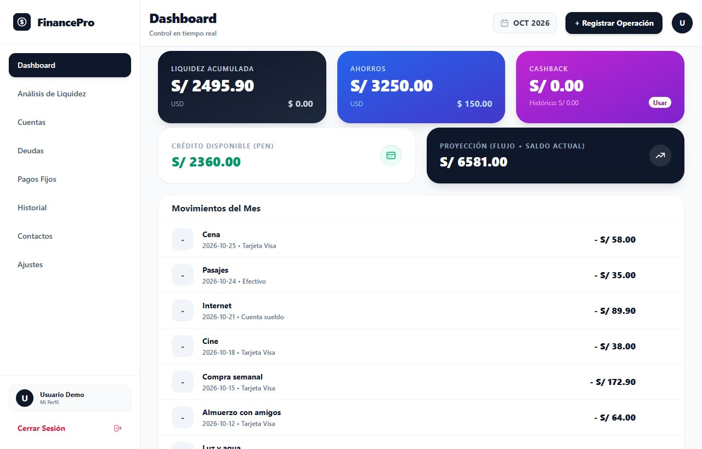
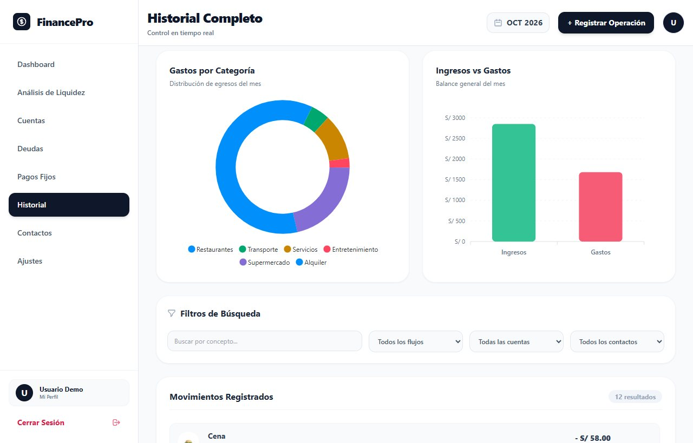
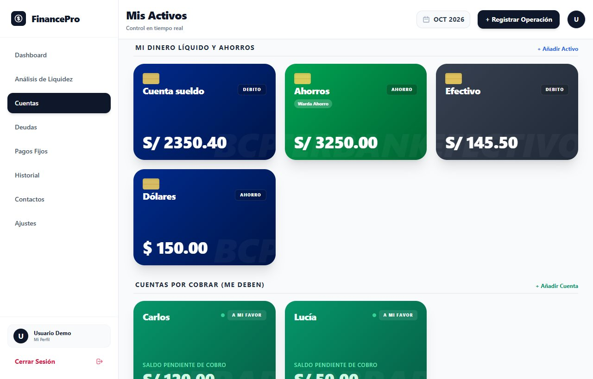
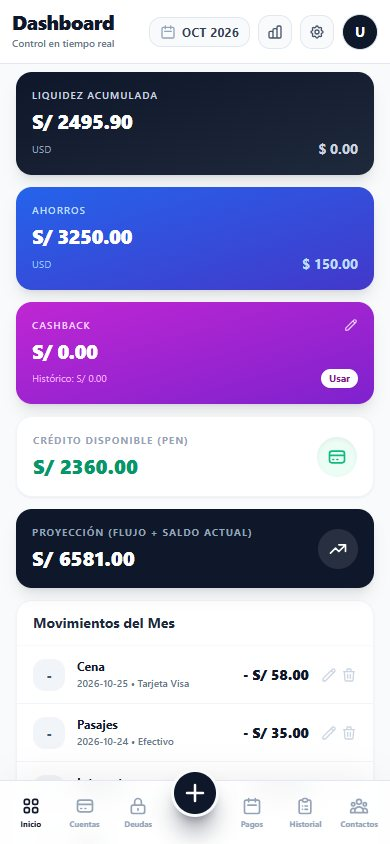
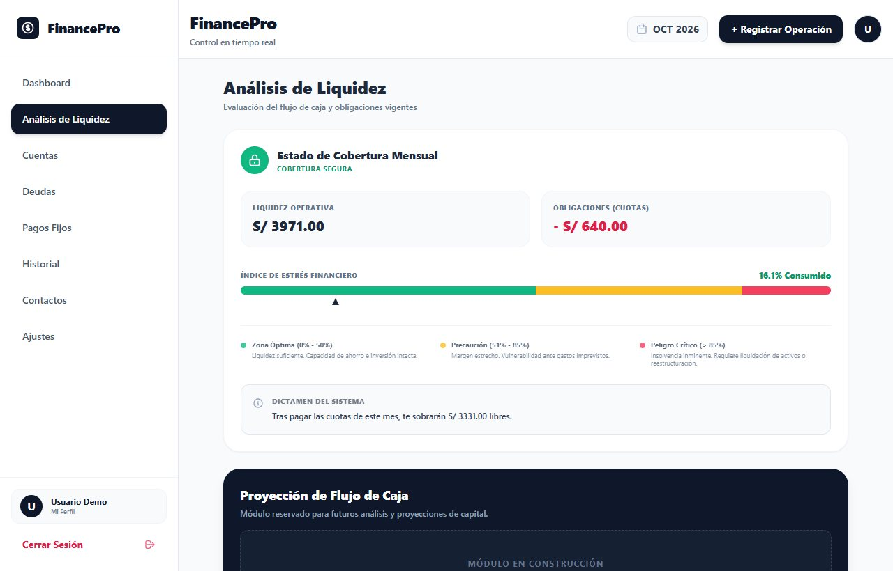

# FinancePro

App web de finanzas personales que hice en abril de 2026: saldos, gastos, deudas y pagos fijos. Estuvo desplegada un tiempo en Vercel y Render; ahora no está en línea, así que este repositorio queda como registro del proyecto.

Las capturas usan un usuario y datos de ejemplo.



## Qué hace

- Inicio de sesión con Google a través de Supabase.
- Cuentas de débito, ahorro y crédito, en soles o dólares, y aparte las cuentas por cobrar.
- Ingresos y gastos con categorías y etiquetas, y un historial con filtros y gráficos de ApexCharts.
- Pagos fijos de cada mes, con el flujo libre que queda después de cubrirlos.
- Deudas y préstamos con otras personas, agrupados por contacto.
- Un análisis de liquidez que compara el dinero disponible con las cuotas del mes y calcula un índice de estrés financiero. La proyección del flujo de caja quedó como módulo en construcción.
- Se instala como PWA, y en el celular la navegación pasa a una barra inferior.



<p>


</p>



## Cómo está armada

El frontend es este repositorio: Vue 3 con Vite y Tailwind CSS. Cada pantalla es un componente en `src/components/`, y la lógica está repartida en composables (`src/js/composables/`) para la sesión, los datos, los cálculos y los gráficos.

El backend está en un repositorio aparte y privado. Es una API en FastAPI con SQLAlchemy sobre PostgreSQL (alojado en Supabase), con endpoints para usuarios, cuentas, transacciones, categorías, etiquetas, pagos fijos, operaciones con terceros y cashback. El frontend la llama desde `src/js/api.js`.

## Ejecutarlo

Copiar `.env.example` como `.env.local` y completar la URL y la clave publishable del proyecto de Supabase, y la URL de la API.

```
npm install --legacy-peer-deps
npm run dev
```

`--legacy-peer-deps` hace falta porque `vite-plugin-pwa` todavía no declara compatibilidad con Vite 8.

© 2026 José Luis Cuenca Gutiérrez. Todos los derechos reservados.
